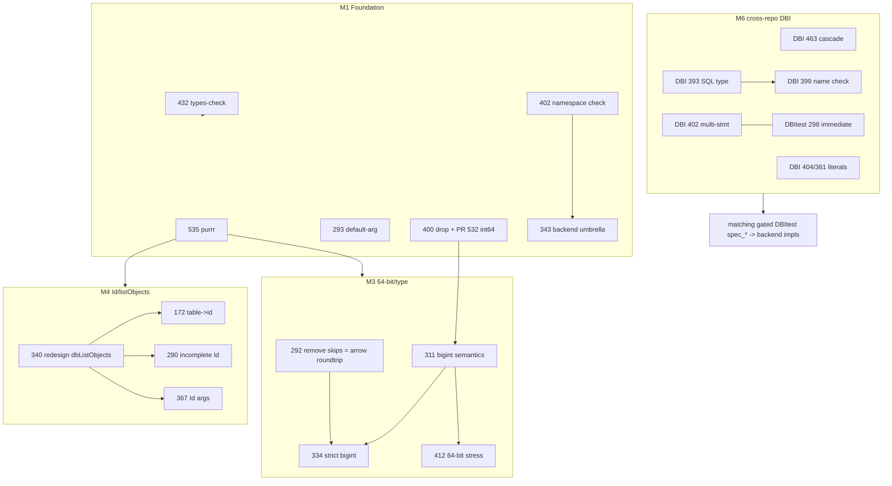

# DBItest / DBI open-issue triage & roadmap

_Snapshot: 2026-11-28.
DBItest: last CRAN release `1.8.3` (2026-07-22), `main` at `1.8.3.9015`.
The DBI section is carried over from the 2026-07-22 snapshot and was not re-checked._

Covers the **36 open DBItest issues** (primary) and **15 DBI issues** (secondary, as of July).
The release-scoped view of the same issues and of the open pull requests is the pre-release review in #585;
this document keeps the longer-term order and dependencies, and agrees with #585 on every recommendation.

Since 1.8.3, `main` gained six Arrow schema specs (#571), lint-driven fixes to the test code, docs fixes, and CI and template work.
Closed since the July snapshot: #428 (noise), #429 (edition 3 is set), #430 (the workflow it refers to no longer exists),
and #170 (`compliance` already requires the DBI subclasses).
New since then: #558.

## The organizing principle

DBItest **is** the executable specification:
DBI's man pages `@inherit` their `return` / `Failure modes` / `Specification` prose from `DBItest::spec_*` at build time.
Consequences that drive the ordering below:

- Any **new DBI generic, argument, or behavior is a two-repo change at least** (DBI generic + DBItest spec),
  and usually an N-repo change once RSQLite / RPostgres / RMariaDB / duckdb implement it.
- The correct sequence for feature work is **spec first, backends second**.
- Fixing the *test harness itself* (so it stops giving wrong answers) must precede expanding coverage,
  otherwise new specs inherit old bugs.
- **A new or stricter spec can break backend test suites** on the next DBItest release.
  Every item marked **(gate)** below needs a tweak or a `skip_if_not_dbitest()` gate,
  so that a backend only sees it once it opts in through its `dbitest_version` tweak, as #571 did.

---

## 0. Close or already resolved on `main`

- #308 `bit64::integer64()` mangled as logical value:
  the reported mangling no longer reproduces on `main`.
  The remainder is PR #532 (compare integer64 logical tweaks by value), which is deferred, see M1.
- DBI #488 `dbWriteTable(value = <SQL query>)`:
  consensus moved the fix to dbplyr's `compute(temporary = FALSE)`.
  **Downgrade / won't-fix in DBI.**
- DBI #516 interface for retries:
  greenfield, no maintainer buy-in, no natural hook in the thin generics.
  Belongs in a wrapper or `pool`.
  **Defer / won't-fix.**

---

## Milestones

### M1 — Foundation & harness trust _(do first, unblocks everything)_

Removes churn risk and fixes the suite producing **wrong results**, which must land before coverage grows.

- #535 purrr usage was reverted, effort S–M.
  The purrr dependency was reverted before 1.8.3, and `R/compat-purrr.R` is what ships.
  `purrr::map()` turns testthat expectation failures into errors, so **keep compat-purrr**.
  What remains is to record that decision and close the issue, before other spec edits churn the same files.
- #432 vendor the rlang `types-check` standalone and apply `check_*()`, effort M.
  PR #433 does this but is about 150 commits behind and conflicts.
  Its new argument checks and the hard error in `check_df()` could break backends with unusual contexts or tweaks,
  so it needs to land behind care for backend suites.
  It is the tooling for the "inline the checks" refactors (PR #424, dev tooling only, stale).
- #293 constructor default `""` false positive, effort S.
  `expect_all_args_have_default_values()` in `R/expectations.R` uses `nzchar(as.character(arg))`,
  which cannot distinguish a missing default from a `""` default.
  Test the empty symbol instead.
  The fix only removes false failures, so backends are safe; a candidate for the next release.
- #400 `drop = TRUE` in the rows check of `test_select()`, effort S.
  Use `rows[[i]][[1L]]` instead of `rows[1L, i]` (`R/spec-result-roundtrip.R`), which loosens the check.
  Optional for the next release.
  PR #532 (the #308 remainder) touches the same helper; defer it,
  since it calls `purrr::map()` without purrr in DESCRIPTION, which would error in backend suites.
  It also adds an unneeded `Additional_repositories` and conflicts in DESCRIPTION.
  Together they gate M3.
- #402 the namespace-only compliance check is faulty, effort M.
  `reexport` in `R/spec-compliance-methods.R` requires backends to re-export DBI generics,
  which backends should not have to do.
  Change it to inspect `NAMESPACE` / `importClassesFrom` instead.
  Still a design question.
- #343 fix backend tests (umbrella).
  Resolves *as* the above land; settle it with a revdep run rather than scheduling it standalone.
  CI here only covers RSQLite, RKazam and MySQL via odbc, so RMariaDB, RPostgres, duckdb and adbi need a revdep run to be seen.

### M2 — Docs & onboarding _(independent, run in parallel with anything)_

- #310 (DBItest) vignette section "When a test fails": how to run one test (`test_some()`) and find its source, effort S.
  The vignette still says `test_some()` integrates dblog, which it no longer does.
  A candidate for the next release.
- #409 (DBItest) clarify `fetch_no_return_value` in `R/spec-result-fetch.R`, effort S.
  The thread already has a ready diff and maintainer consensus.
  A candidate for the next release.
- PRs #564 (goals and non-goals) and #565 (`README.Rmd`, stacked on #564), docs only.
  Include both in the next release, #564 first.
- DBI #358 document the `pool` keepalive trick, effort S.
- DBI #532 document the closure-based finalizer pattern in `?dbDisconnect`, effort S.
- DBI #252 / #339 data import/export and tutorial content in `DBI-1.Rmd` / `DBI-advanced.Rmd`, effort M.

### M3 — 64-bit / type semantics _(depends on M1: #400 and PR #532)_

- #311 define `bigint = "integer64"` semantics (adbi always returns int64),
  likely a tweak akin to `logical_return`.
  **First in the cluster.** (gate)
- #334 "strict" bigint mode (`integer-strict` / `numeric-strict`) and expanded `data_64_bit_*` specs.
  After #311; the Arrow items also need #292. (gate)
- #412 stress 64-bit edges (non-representable ints 2^55–2^63, `NULL` vs `-2^63`).
  After #311. (gate)
- #264 `dbDataType()` for zero-length vectors (`list()`, `list_of()`).
  Type-adjacent, can run independently. (gate)
- #292 remove unconditional `skip()`s.
  The truly unconditional ones are the six Arrow stubs that read "Internal: Need to enhance `test_arrow_roundtrip()`"
  in `R/spec-arrow-append-table-arrow.R` and `R/spec-arrow-write-table-arrow.R`,
  so #292 means finishing the Arrow 64-bit roundtrip, overlapping #334.
  Removing the skips would turn the tests on for every backend. (gate)

### M4 — Identifier / `Id()` / `dbListObjects()` _(design-gated cluster)_

- #340 redesign `dbListObjects()` (`prefix_level = c("catalog", "schema", …)`).
  **Design anchor, decide first.** (gate)
- #172 `dbListObjects()` `"table"` → `"id"` column, keeping `"table"` for back-compat.
  Implements part of #340 (`R/spec-sql-list-objects.R`). (gate)
- #290 spec `dbQuoteIdentifier()` for incomplete `Id()` (terminal-dot behavior).
  After the design (`R/spec-sql-unquote-identifier.R`). (gate)
- #367 table functions with named/unnamed `Id()` and `catalog.schema.table`; default schema/catalog as a tweak.
  After the design. (gate)

### M5 — Spec-coverage backlog _(largely independent, parallelizable sub-clusters)_

Every item here is a new or stricter spec. (gate)

- **Encoding:**
  - #149 `dbQuoteString()` UTF-8.
  - #156 invalid Unicode; mostly fixed upstream, add a graceful-handling test.
  - #173 Windows column-name encoding not caught.
- **BLOB / list columns:**
  - #161 long strings and blobs (~64k).
  - #294 all-NULL lists → BLOB.
  - #338 test `vctrs_list_of`, drop `list(raw())`.
- **`dbAppendTable()`:**
  - #259 0-row tables.
  - #262 `Id` objects.
- **Result / statement:**
  - #158 result invalidated when a new one opens.
  - #160 `dbRowsAffected()` after drop.
  - #261 `RETURNING` (duckdb-driven).
  - #558 statements with side effects in `dbSendQuery()`:
    `dbFetch()` should return a data frame with standardized column names, borrowing from other adapters.
    Pairs with #261 and #409.
  - #298 multiple statements with `immediate = TRUE`.
  - #368 vector broadcasting for parameterized queries (no mixed-length/recycling test today).
  - #369 duplicate column names.
- **Helpers:**
  - #127 `sqlData()` and helpers (labelled *ready*).
  - #144 tweak to invalidate a connection.
- PR #401 casts to `data.frame` in `get_query_good_after_bad_n`.
  It only loosens a check, so include it if the spec should accept data frame subclasses;
  a third identical spot is not covered.

### M6 — Cross-repo DBI features _(spec first, then backends)_

Ordered by readiness / value; each needs a gated DBItest spec.

1. **DBI #463: `cascade` for `dbRemoveTable()`.** _Cleanest of all._
   Direct precedent: `fail_if_missing` / `temporary` already ride in `...` and are DBI spec, not DBI generic.
   About zero DBI-core code, a paragraph in `spec_sql_remove_table`, then backends append `" CASCADE"`.
   The approach is already agreed.
2. **DBI #393: SQL type in `dbColumnInfo()`.** Foundational.
   The spec already permits `.`-prefixed optional columns, so a standardized `type.sql` is a `spec_meta_column_info` change plus backends.
   **Enables DBI #399** (`dbWriteTable()` output-column-name check);
   DBI's default `dbAppendTable()` currently binds **by position, not name**, which is the substance of that concern.
3. **DBI #404 + #361: literal-quoting robustness.**
   A one-line `sprintf("%.17g")` in DBI's `dbQuoteLiteral()` method,
   **but** the earlier fix for #404 was reverted for revdep failures.
   It must be type-guarded, with a snapshot / `spec_sql_quote_literal` update and a revdep run.
   #361 (Inf needs a cast) is the same area (per-driver `dbQuoteLiteral()`, RPostgres) plus a `?dbBind` doc note.
4. **DBI #402 ↔ DBItest #298: multi-statement.**
   Design-heavy; the community wants native driver passthrough only, no R-side SQL splitting.
   Pair the DBI generic decision with the DBItest `immediate = TRUE` test.
5. **DBI #413: `check_dots_used()`.**
   A new rlang dependency, with a risk of false positives because `...` is deliberately forwarded to backend methods.
   Design carefully.
6. **DBI #514: `dbDataType()` AsIs default dispatch.**

### Defer / external

- DBItest #348 (Oracle): needs an Oracle testbed (Docker XE 19/21).
  Infra-heavy; defer until a CI Oracle image exists. (gate)
- DBI #365 (R's `R-data.html`): not this repo; a draft exists, awaiting an R-dev-day slot.
  Track externally.
- Stale pull requests: #333 (WIP inline `test_select()`, 284 commits behind) and #267 (`use_dbitest()`, 760 commits behind,
  would export 33 helpers) are internal refactors; #585 recommends closing them.

---

## Dependency graph



Text form of the load-bearing edges:

- #400 and PR #532 → #311 → {#334, #412}; #292 (Arrow) → #334.
- #402 → #343 (umbrella, settled by a revdep run).
- #535 and #432 are foundation; they precede spec-file churn and the "inline the checks" work.
- #340 (design) → {#172, #290, #367}.
- DBI #393 → DBI #399; DBI #404 ⟷ DBI #361; DBI #402 ⟷ DBItest #298.
- **Every M6 DBI item** → matching gated DBItest `spec_*` → backend implementations.

---

## Suggested execution order

```
next release (#293, #310, #409, optional #400, PRs #564/#565/#401)  →  rest of M1  →  M3  →  M4  →  M6 #463 & #393  →  M5 backlog  →  M6 #404/#361, #402/#298, #413  →  defer
```

The next release takes only changes that cannot make backend tests stricter.
The rest of M1 makes the harness trustworthy and settles the validation churn; M2 floats free and can be picked off anytime.
M3 needs the integer64 fix from M1, and M4 is self-contained behind one design call (#340).
M6 #463 and #393 are the highest-value, lowest-cost DBI features, and #393 unlocks #399.
The M5 backlog is steady-state coverage work that slots into any gap, each item behind a gate.

---

## Appendix — full issue index

### DBItest (36)

- **M1:**
  - #293 constructor default `""` false positive (next release).
  - #308 (bug) `bit64::integer64()` as logical value; no longer reproduces, remainder is PR #532.
  - #343 fix backend tests (umbrella).
  - #400 `drop = TRUE` in the rows check (optional for the next release).
  - #402 change the namespace-only compliance check.
  - #432 import the rlang `types-check` standalone (PR #433).
  - #535 purrr usage reverted; keep compat-purrr.
- **M2:**
  - #310 docs: what to do when a test fails (next release).
  - #409 docs: clarify `fetch_no_return_value` (next release).
- **M3:** (gate)
  - #264 `dbDataType()` for zero-length vectors.
  - #292 remove unconditional skips (= finish the Arrow roundtrip).
  - #311 `bigint = "integer64"` strict semantics.
  - #334 "strict" bigint mode.
  - #412 stress-test 64-bit integer edge cases.
- **M4:** (gate)
  - #172 `dbListObjects()` `"table"` → `"id"` column.
  - #290 `dbQuoteIdentifier()` for incomplete `Id()`.
  - #340 redesign `dbListObjects()` (`prefix_level`).
  - #367 table functions with named/unnamed `Id()` arguments.
- **M5:** (gate)
  - #127 spec `sqlData()` and helpers (labelled *ready*).
  - #144 tweak to invalidate a connection (backends surviving serialization).
  - #149 test UTF-8 encoding of `dbQuoteString()`.
  - #156 invalid-Unicode strings (low; largely fixed upstream).
  - #158 result set becomes invalid when a new one is created.
  - #160 sensible `dbRowsAffected()` after dropping a table.
  - #161 roundtrip of long strings and blobs (~64k).
  - #173 Windows column-name encoding issues not caught (low).
  - #259 `dbAppendTable()` for 0-row tables on all backends.
  - #261 test the `RETURNING` clause (no warning, returns a data frame).
  - #262 `dbAppendTable()` for `Id` objects.
  - #294 roundtrip of all-NULL lists → BLOB.
  - #298 multiple statements with `immediate = TRUE` (↔ DBI #402, M6).
  - #338 test only `vctrs_list_of`, not `list(raw(...))`.
  - #368 vector broadcasting for parameterized queries.
  - #369 specify duplicate-column-name behavior.
  - #558 statements with side effects in `dbSendQuery()`.
- **Defer:**
  - #348 Oracle support (low; needs a testbed). (gate)

### DBI (15, as of 2026-07-22)

- **M2:**
  - #252 better data import/export docs.
  - #339 tutorial feedback (time zones, type checks, blobs).
  - #358 document the `pool` keepalive trick.
  - #532 document connection-disconnect best practice.
- **M6:**
  - #361 infinite values need an explicit cast (docs + RPostgres `dbQuoteLiteral()`).
  - #393 get the SQL type of a column via `dbColumnInfo()`.
  - #399 `dbWriteTable()` compares input/output column names (needs #393).
  - #402 multi-statement support (↔ DBItest #298).
  - #404 (bug) `dbQuoteLiteral()` numeric precision (prior fix reverted).
  - #413 `check_dots_used()` in `dbGetQuery()` and friends.
  - #463 `cascade` option for `dbRemoveTable()` (cleanest; agreed).
  - #514 `dbDataType()` AsIs default dispatch.
- **Downgrade / defer / external:**
  - #365 update R's `R-data.html` (low; external).
  - #488 `dbWriteTable(value = query)` (low; moved to dbplyr).
  - #516 retry interface (low; greenfield).
